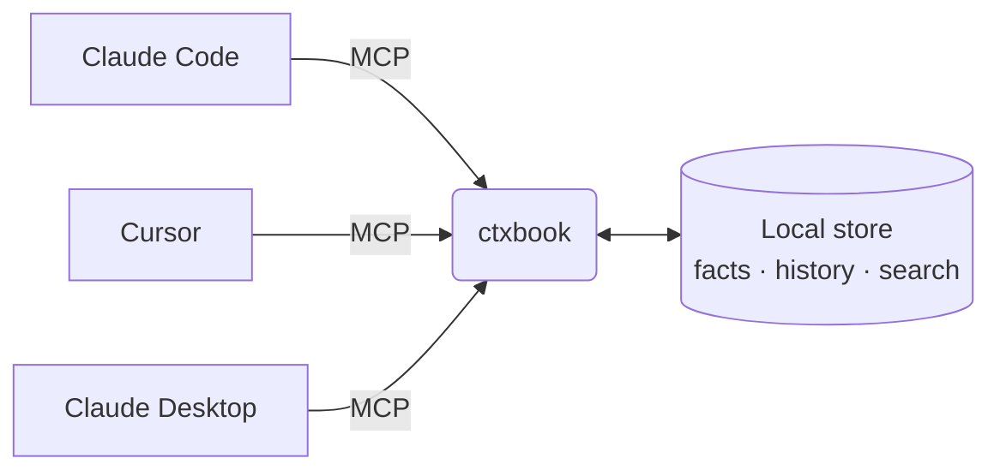
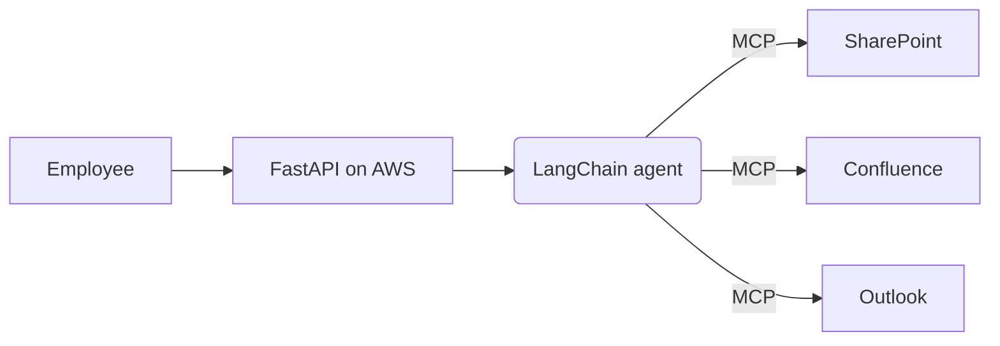
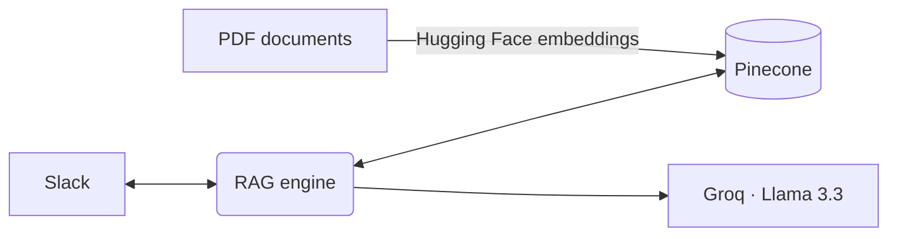

<a href="#about"><b>About</b></a> &nbsp;·&nbsp; <a href="#selected-work"><b>Work</b></a> &nbsp;·&nbsp; <a href="#stack"><b>Stack</b></a> &nbsp;·&nbsp; <a href="#contact"><b>Contact</b></a> &nbsp;&nbsp;|&nbsp;&nbsp; <a href="https://www.linkedin.com/in/guptamayank7199/">LinkedIn ↗</a> &nbsp;·&nbsp; <a href="mailto:guptamayank7199@gmail.com">Email ↗</a>

## About

I'm a GenAI engineer with 5+ years of Python behind me: backend APIs first, then classical ML, and now LLM systems. Most of my recent work connects models to the places a company's knowledge actually lives, like SharePoint, Confluence, Outlook and Slack.

I also train developers, and I write on [LinkedIn](https://www.linkedin.com/in/guptamayank7199/) about what goes wrong when RAG meets real documents.

<table>
<tr>
<td width="33%" valign="top">01 <b>Measure retrieval before tuning prompts</b>  A small eval set decides whether a change actually helped.</td>
<td width="33%" valign="top">02 <b>Give agents the fewest permissions that work</b>  Validate tool inputs, and decide the failure path up front.</td>
<td width="33%" valign="top">03 <b>Keep the infrastructure boring</b>  FastAPI, Postgres, Docker, AWS: things the next engineer can run.</td>
</tr>
</table>

## Selected work

### [ctxbook](https://github.com/ms7199/ctxbook) &nbsp;open source · in development

**One shared memory for every AI tool you use.** Tell Claude Code your project uses Postgres and Cursor knows it too. Move to MongoDB and the old fact is replaced, not duplicated. ctxbook is a local-first MCP server, so your notes stay on your machine.

`Python` `FastMCP` `MCP` `Hybrid search`

<b>Progress toward v0.1</b>

 

- [x] Storage with fact history
- [x] Hybrid search and conflict handling
- [x] 6 MCP tools
- [x] `serve`, `save`, `export`, `import` and `doctor` commands
- [ ] `ctxbook init` for automatic client setup
- [ ] Evaluation suite
- [ ] Release on PyPI

> [!NOTE]
> ctxbook is pre-release and not on PyPI yet. Follow progress in the [repository](https://github.com/ms7199/ctxbook).

### More work &nbsp;click a project to expand it

<b>HR Assistant</b> &nbsp;·&nbsp; client work &nbsp;·&nbsp; <code>LangChain</code> <code>MCP</code> <code>FastAPI</code> <code>AWS</code>

 

**Problem.** HR teams answer the same policy and leave questions every day, and the answers are spread across SharePoint, Confluence and email.

**What I built.** An assistant that calls SharePoint, Confluence and Outlook as MCP tools, so answers come from the source systems instead of a stale copy. Each tool is scoped to what it may touch.

<b>docubot-slack</b> &nbsp;·&nbsp; open source &nbsp;·&nbsp; <code>RAG</code> <code>Groq</code> <code>Pinecone</code> <code>Slack API</code>

 

**Problem.** The answers people ask for in Slack are usually buried in PDFs.

**What I built.** A Slack bot that answers questions from your PDF documents using RAG. It keeps conversation context and reloads the knowledge base without a restart. [View the repository →](https://github.com/ms7199/docubot-slack)

<b>Memory Assistant</b> &nbsp;·&nbsp; project &nbsp;·&nbsp; <code>LangChain</code> <code>Groq</code> <code>Pinecone</code> <code>MongoDB</code> <code>Next.js</code>

 

**Problem.** Chatbots forget you between sessions, but storing everything makes the context grow without bound.

**What I built.** Long- and short-term memory for a chat assistant. Memories are scored, pruned and recalled semantically, so it remembers users while the context stays small.

## Stack

| Area | Tools |
|---|---|
| **LLMs & agents** | OpenAI, Groq, LangChain, LangGraph, MCP / FastMCP, Guardrails, Hugging Face |
| **Retrieval** | Pinecone, FAISS, hybrid search, re-ranking, Sentence-Transformers |
| **ML & MLOps** | PyTorch, TensorFlow, scikit-learn, Transformers (BERT, T5), spaCy, MLflow |
| **Backend** | Python, FastAPI, Django REST Framework, Node.js, Celery, Redis, JWT / OAuth2 |
| **Cloud & data** | AWS (EC2, Lambda, S3, ECR, DynamoDB), Azure, Docker, CI/CD, PostgreSQL, MongoDB |
| **Integrations** | SharePoint, Confluence, Outlook, Slack, Stripe, Razorpay, Twilio, SendGrid |

## Contact

**Building something with LLMs?** I'm open to senior GenAI / AI Engineer roles, remote or hybrid, and happy to talk about RAG, agents or MCP.

📫 **[guptamayank7199@gmail.com](mailto:guptamayank7199@gmail.com)** &nbsp;·&nbsp; [LinkedIn](https://www.linkedin.com/in/guptamayank7199/) &nbsp;·&nbsp; [Stack Overflow](https://stackoverflow.com/users/9546688/mayank-gupta) &nbsp;·&nbsp; [X](https://x.com/msgupta_07)

