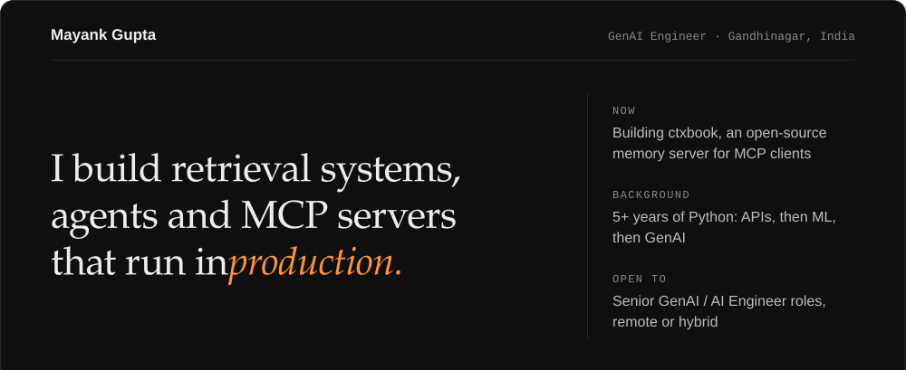
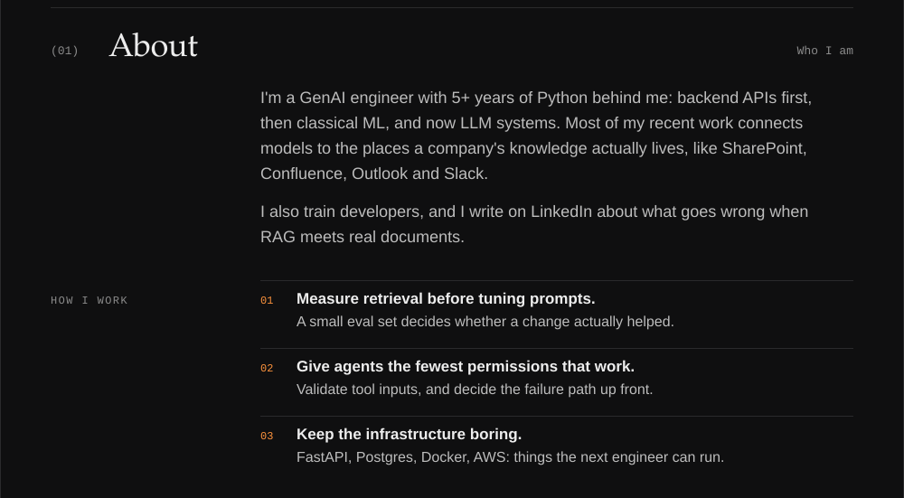
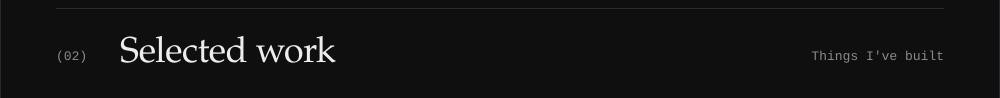
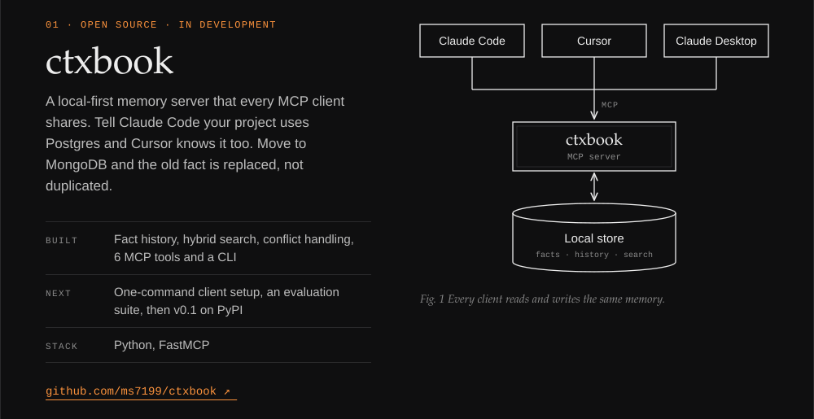
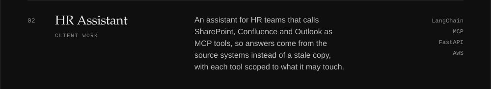
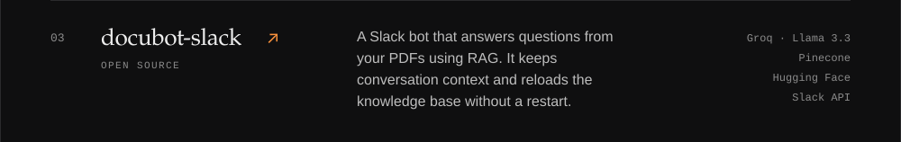
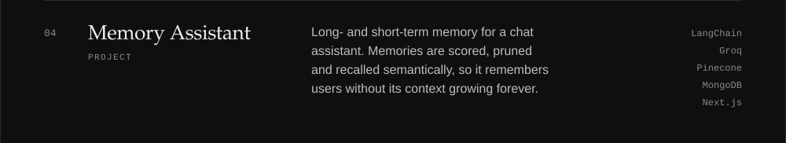
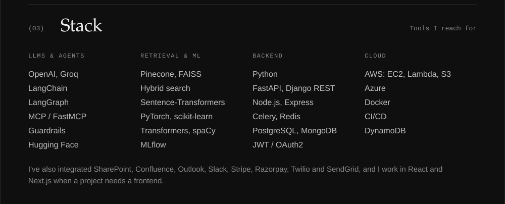
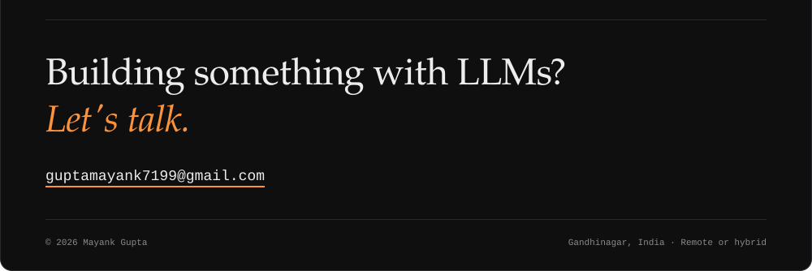

 
 
 
 
 
 
 
 

<a href="https://www.linkedin.com/in/guptamayank7199/">LinkedIn</a> &nbsp;·&nbsp; <a href="mailto:guptamayank7199@gmail.com">Email</a> &nbsp;·&nbsp; <a href="https://github.com/ms7199/ctxbook">ctxbook</a> &nbsp;·&nbsp; <a href="https://stackoverflow.com/users/9546688/mayank-gupta">Stack Overflow</a> &nbsp;·&nbsp; <a href="https://x.com/msgupta_07">X</a>

